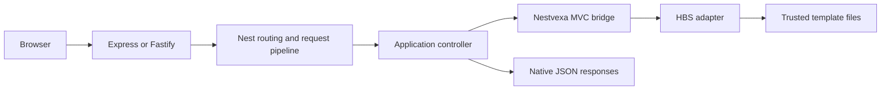

# Architecture

The first implemented slice preserves Nest request handling: HTTP adapter → Nest router → middleware/guards/pipes/interceptors → controller `@Render` result → Nest view bridge → HBS engine → escaped HTML. Request-scoped provider resolution belongs to Nest. No custom action dispatcher claims pipeline parity.

Core stores immutable configuration and registry definitions, never request state. View engines are application-local instances. HTML output is not cached across users. Compiled-template caching is distinct from data caching. Runtime module initialization and the HTTP view bridge are explicit.

Live, actions, Inertia and client ownership boundaries are specified in the source prompt but not implemented yet. No architecture diagram is evidence those systems exist. See [integration tests](../../tests/integration.test.ts) for implemented behavior and [threat model](../security/threat-model.md) for trust boundaries.
