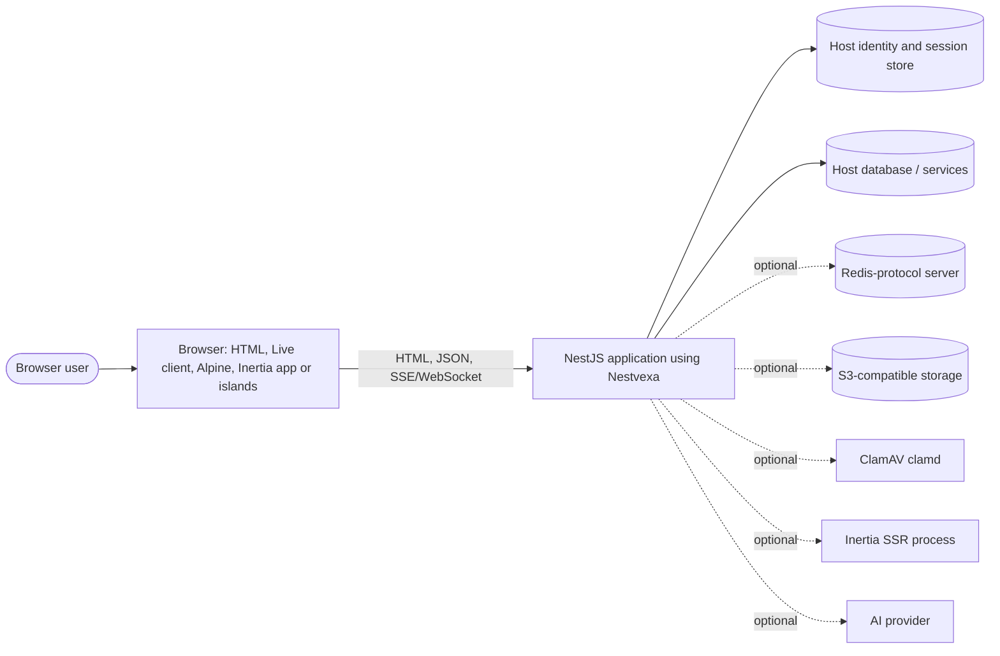
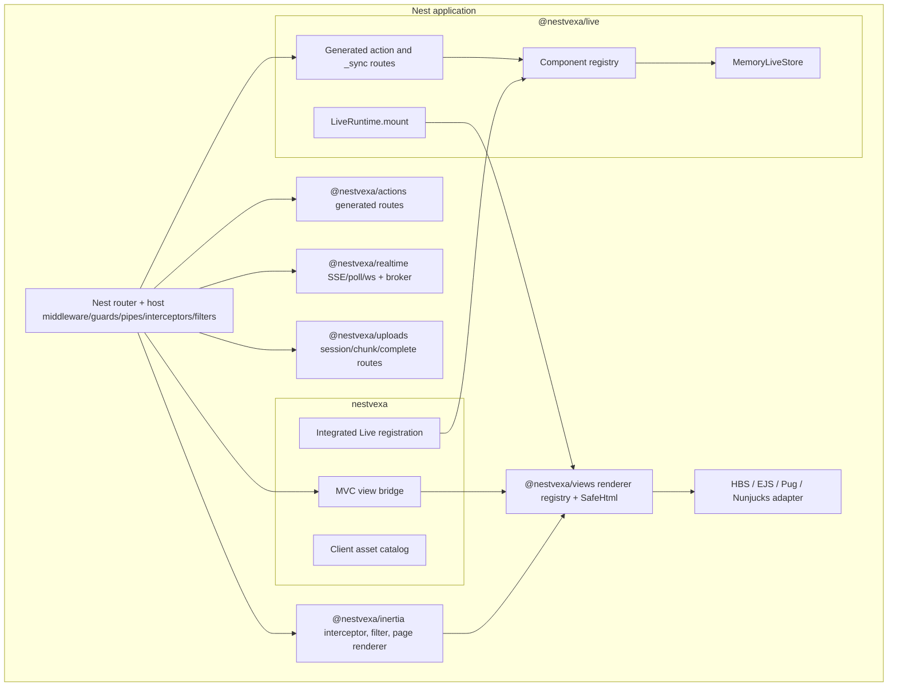
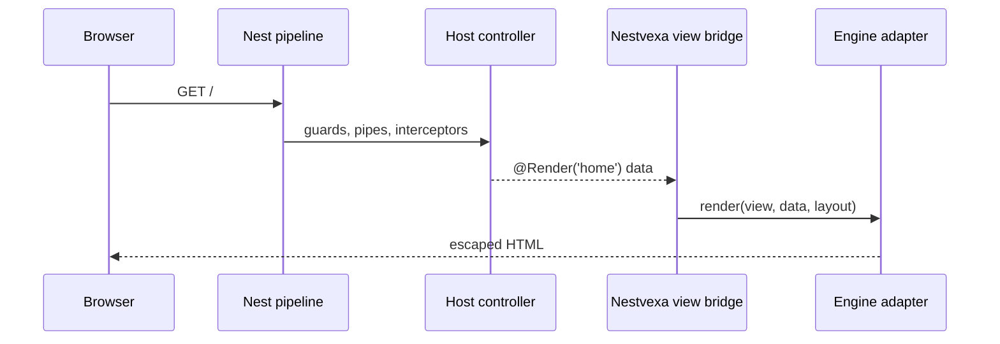
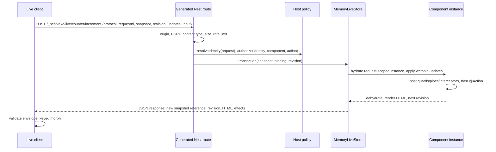
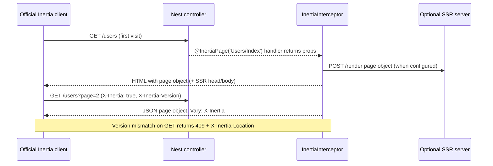
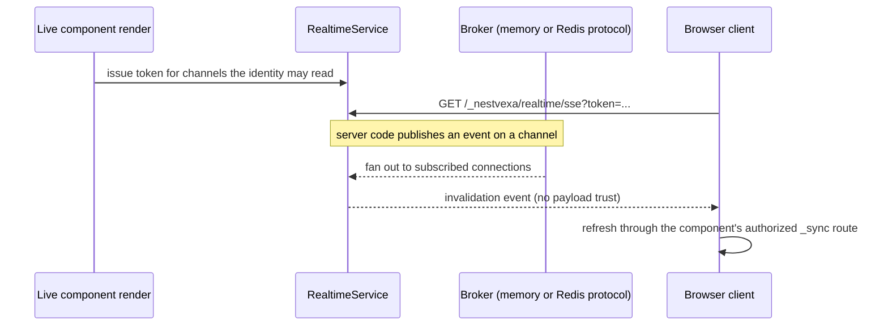

# Architecture overview

Refreshed **2026-11-05** against the 28 packages in `packages/` at version
`0.1.0-alpha.0`. Diagrams describe code that exists; each section links the tests that
exercise it. Gaps are called out explicitly. The declared package graph, with drift
checks, is in [package dependency graph](package-dependency-graph.md); requirement
status is in the [feature matrix](../feature-matrix.md).

## Principles

1. **Nest stays in charge.** Every Nestvexa HTTP entry point is an ordinary Nest
   controller route, so host middleware, guards, pipes, interceptors, filters, DI scopes
   and the Express or Fastify adapter apply ([ADR 0003](../adr/0003-nest-execution-pipeline.md)).
2. **Small kernel, opt-in features.** `@nestvexa/core` and `@nestvexa/views` hold
   contracts; renderers, engines and services are separate packages. The `nestvexa`
   umbrella composes the default HBS + Live + Alpine stack ([ADR 0001](../adr/0001-architecture.md)).
3. **Explicit trust boundaries.** Browser input is untrusted; templates and component
   classes are trusted application code. Components, actions, channels and upload
   purposes are allowlisted at registration; nothing is resolved from client-supplied
   class or method names ([ADR 0006](../adr/0006-security-and-trust-boundaries.md)).
4. **One owner per DOM root.** HBS/Live, Inertia apps and framework islands never share
   a DOM subtree; crossing incompatible roots is a full document navigation
   ([ADR 0004](../adr/0004-renderers-and-islands.md)).

## System context

The host application owns authentication, sessions, the database, deployment, CSP
and TLS. Nestvexa never ships an identity provider, ORM or queue framework (VISION-020).

## Containers

| Container            | Packages                                                                                                                                                                                                                                            | Runs in                                     |
| -------------------- | --------------------------------------------------------------------------------------------------------------------------------------------------------------------------------------------------------------------------------------------------- | ------------------------------------------- |
| Kernel and rendering | `@nestvexa/core`, `@nestvexa/views`, `@nestvexa/engine-hbs`, `@nestvexa/engine-ejs`, `@nestvexa/engine-pug`, `@nestvexa/engine-nunjucks`                                                                                                            | Nest process                                |
| Default distribution | `nestvexa` (MVC bridge, integrated Live registration, `nestvexa/assets` client asset hosting, `nestvexa` bin)                                                                                                                                       | Nest process                                |
| Live server          | `@nestvexa/live`, `@nestvexa/forms`, `@nestvexa/uploads`                                                                                                                                                                                            | Nest process                                |
| Browser runtime      | `@nestvexa/client`, `@nestvexa/alpine`, browser subpaths of `@nestvexa/ui`, `@nestvexa/ai`, `@nestvexa/offline`, `@nestvexa/islands`, `@nestvexa/actions`                                                                                           | Browser                                     |
| Inertia and Vite     | `@nestvexa/inertia` (server adapter), `@nestvexa/vite` (manifest, dev server, SSR bundles), `@nestvexa/react`, `@nestvexa/vue`, `@nestvexa/svelte` (official client boot and SSR entry helpers)                                                     | Nest process, browser, optional SSR process |
| Hybrid               | `@nestvexa/islands` (allowlisted island registry and browser mounters)                                                                                                                                                                              | Nest process, browser                       |
| Universal actions    | `@nestvexa/actions` (registry, generated routes, typed client codegen)                                                                                                                                                                              | Nest process, build                         |
| Distributed services | `@nestvexa/realtime` (SSE/WebSocket/poll invalidation, Redis-protocol broker, presence, jobs), `@nestvexa/realtime-redis` (shared Live state store and broker for multiple replicas), `@nestvexa/cache` (privacy-scoped cache, tags, single flight) | Nest process                                |
| Extensions           | `@nestvexa/i18n`, `@nestvexa/ui`, `@nestvexa/ai`, `@nestvexa/flags`, `@nestvexa/offline`, `@nestvexa/observability`, `@nestvexa/mail`                                                                                                               | Nest process, browser                       |
| Tooling              | `@nestvexa/cli` (`nestvexa` command), `nestvexa-actions-codegen`, `nestvexa-i18n-extract`                                                                                                                                                           | Developer machine, CI                       |

## Components inside the Nest process

Core stores immutable configuration and registries, never request state. Engines are
application-local instances; compiled-template caching never caches rendered HTML
across users.

## Information flows

### MVC page

Tests: [integration](../../tests/integration.test.ts), [views](../../tests/views.test.ts),
[engines](../../tests/engine-live.test.ts).

### Live action

A stale revision returns `409`, an expired or unknown snapshot `410`. Browser
snapshots are opaque references to server-side state; public fields still reach the
browser in HTML and responses, so secrets never belong in component state
([ADR 0002](../adr/0002-live-protocol.md), [ADR 0005](../adr/0005-state-and-concurrency.md),
[Live protocol guide](../guides/live-protocol.md)). Tests:
[live](../../tests/live.test.ts), [live security](../../tests/live-security.test.ts),
[umbrella Live](../../tests/umbrella-live.test.ts), browser specs in
[tests/browser](../../tests/browser).

Live state is held in a pluggable `LiveStore`. The default `MemoryLiveStore` is per
process: a restart invalidates open components, and replicas need sticky sessions.
`RedisLiveStore` from `@nestvexa/realtime-redis` shares state between replicas
([ADR 0032](../adr/0032-distributed-state-and-redis.md)). It passes the shared
[store contract suite](../../tests/live-store-contract.test.ts) and a real Redis 7
two-replica browser run.

> **Known gap:** the Redis store supports a single Redis primary only. There is no
> Sentinel discovery or tested failover, and Redis Cluster is not supported (DATA-004).
> Cross-replica idempotent replay and identity locks are tested only against the
> in-process RESP test double (LIVE-007).

### Inertia visit

The server adapter implements the Inertia v3 protocol; the official
`@inertiajs/react`, `@inertiajs/vue3` and `@inertiajs/svelte` clients do the browser
work ([ADR 0018](../adr/0018-inertia-server-adapter.md),
[ADR 0024](../adr/0024-frontend-adapters-and-ssr.md), [Inertia guide](../guides/inertia.md)).
Tests: [protocol](../../tests/inertia-protocol.test.ts), [HTTP](../../tests/inertia-http.test.ts),
[golden](../../tests/inertia-golden.test.ts), [security](../../tests/inertia-security.test.ts).

### Universal server action

The browser (or a typed client generated by `nestvexa-actions-codegen`) calls
`POST /_nestvexa/actions/<group>/<action>`. Only methods decorated as actions on
registered groups become routes; the request passes exact origin, JSON content type,
size, identity and policy checks and then the host Nest pipeline
([ADR 0019](../adr/0019-universal-server-actions.md), [guide](../guides/server-actions.md)).

### Realtime invalidation

Events invalidate; they never carry authoritative state
([ADR 0009](../adr/0009-realtime-backpressure.md), [realtime guide](../guides/realtime.md)).

### Upload

Browser → `POST <uploads endpoint>/sessions` → chunked bytes into a private temporary
directory → `complete` inspects content (and optionally scans with ClamAV) and returns
a single-use, identity-bound token → a Live action or CSRF-protected host route calls
`UploadsService.finalize(request, token, { purpose })` to commit to local or S3 storage
([ADR 0023](../adr/0023-uploads-and-storage.md), [uploads guide](../guides/uploads.md)).

### Hybrid page

An HBS or Live page renders island placeholders through the allowlisted
`IslandRegistry`; the `@nestvexa/islands/client` mounter hydrates each placeholder with
the React, Vue or Svelte component registered for it. The framework owns the island
root: Live and Alpine never patch inside it and Live morphs keep island roots in place
([islands guide](../guides/islands.md)).

## Extensibility

| Extension point  | Contract                                                                                                                                                                                 |
| ---------------- | ---------------------------------------------------------------------------------------------------------------------------------------------------------------------------------------- |
| View engine      | `@nestvexa/views` engine adapter contract ([template engines](../guides/template-engines.md), `examples/custom-engine`)                                                                  |
| Live state store | `LiveModule` `store` option (`MemoryLiveStore`; `RedisLiveStore` in `@nestvexa/realtime-redis`)                                                                                          |
| Action policies  | Host `resolveIdentity`/`authorize` callbacks and Nest guards                                                                                                                             |
| Upload storage   | Storage adapter interface; local and S3 SigV4 shipped                                                                                                                                    |
| Cache store      | `CacheStore` interface; memory implementation shipped                                                                                                                                    |
| Realtime broker  | Broker interface; in-memory and Redis-protocol (`RespRealtimeBroker`) shipped                                                                                                            |
| Island renderers | `@nestvexa/islands` React/Vue/Svelte mounters                                                                                                                                            |
| Instrumentation  | `@nestvexa/observability` spans, metrics and redacted logging hooks                                                                                                                      |
| CLI generators   | Built-in only                                                                                                                                                                            |
| Kernel hooks     | `@nestvexa/core` `NestvexaExtension` (version range, capabilities, `register`, `contributeContext`, `shutdown`); the legacy `PluginRegistry` is a deprecated adapter (`pluginExtension`) |

`@nestvexa/core` also provides the kernel services of specification section 5.2:
`RequestContextFactory` (tenant/session/principal/correlation/CSP nonce with a public
subset), `SecurityPolicyRegistry` (CSRF, origin, snapshot, action authorization, upload
quotas; fail-closed evaluation), `DiagnosticsRegistry` (typed events, metrics and spans
for tests and devtools) and `NestvexaExceptionFilter` (error envelope with correlation
IDs and redacted logging). See the [core README](../../packages/core/README.md#kernel-services).
The registries are the single source of the security policies: Live, uploads, server
actions and Inertia (opt-in `security`) register their origin, CSRF, authorization,
snapshot and upload-quota policies there and ask the registry for each decision through
structural interfaces (no package imports core,
[ADR 0030](../adr/0030-live-kernel-boundary.md)); the `nestvexa` umbrella wires Live,
views (`nvRequest`), and exposes the registries to actions, uploads, realtime, Inertia
and devtools. `NestvexaRegistry` lists the installed features (components, safe
actions, views, renderer adapters, capabilities) and plugins, and
`RequestContextFactory.identity(request)` is the opt-in `kernelIdentity` source that
gives MVC, Live, Inertia, server actions, uploads and realtime one principal and tenant
per request.

`@nestvexa/core` also has a `PluginRegistry`. It validates plugin manifests (name,
version, supported Nestvexa range and capabilities from `PLUGIN_CAPABILITIES`), refuses
incompatible ranges and installs after `seal()`, and never loads code from a name or URL
([core README](../../packages/core/README.md)).

> **Known gap:** section 29.1 of the specification asks for a stable, versioned plugin
> SDK with a third-party example package consumed from tarballs. The plugin registry is
> separate from the extension hooks, the other contracts above remain package-level
> interfaces, and no out-of-tree plugin package has been consumed from a tarball yet
> (MAINT rows). CLI generators are not pluggable.

## Where to go next

- [Package dependency graph](package-dependency-graph.md) and
  [ADR 0029](../adr/0029-peer-dependencies-and-singletons.md) for peers and singletons.
- [Upstream compatibility](upstream-compatibility.md) for the tested version matrix.
- [Threat model](../security/threat-model.md) and [hardening](../security/hardening.md).
- [ADR index](../adr/README.md).
