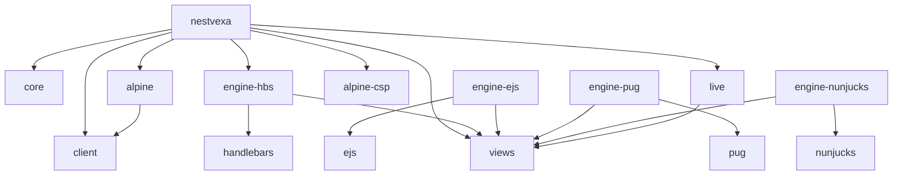

# Package dependency graph

`engine-ejs`, `engine-pug` and `engine-nunjucks` are optional, separately installed adapters. The umbrella does not depend on them, so the default install stays HBS-only; the [boundary script](../../scripts/boundaries.mjs) fails if the umbrella declares one or if core/views import any engine. See the [template engine guide](../guides/template-engines.md).

The graph shows declared runtime package dependencies. `alpine-csp` denotes `@alpinejs/csp`; `alpine` denotes `@nestvexa/alpine`. That bridge also declares optional peer ranges for the CSP and ordinary Alpine distributions. The umbrella pins CSP 3.17.5 for its explicit asset-serving capability. Installing that dependency does not start Alpine or add a SPA renderer. Nest HTTP adapters and the packages' declared Nest/reflect-metadata/RxJS peers remain host-owned.

Core imports no renderer/browser runtime and has no DOM globals. Views currently needs no kernel runtime imports, so it depends on the engine contract rather than importing core unnecessarily. Live is a separate server module using Nest DI and views. Client is browser-oriented, and the Alpine bridge consumes its public operations; neither browser package imports Nest.

The umbrella root implements the MVC bridge and explicit integrated Live registration. One exported renderer module supplies the HBS engine to MVC and the async Live policy factory through ordinary module visibility. Its `nestvexa/assets` subpath snapshots approved installed browser files during Nest initialization without executing browser modules on the server. Integrated registration adds a neutral boot route that delegates browser startup; standalone/manual hosts retain the asset subpath. This keeps browser assets outside core and does not install React/Vue/Svelte SPA frameworks.

All package outputs are ESM with declaration files. Dual CommonJS output is deferred until a demonstrated requirement and identity tests justify it. [Asset hosting and migration](../guides/client-assets.md) describes readiness, prefixes, caching, shutdown and deployment limits.

`pnpm lint` executes [boundary checks](../../scripts/boundaries.mjs), including runtime dependency cycle detection. [Package contract tests](../../tests/contracts.test.ts) check entries and a non-browser core import. Browser DOM, real Nest and packed external-consumer checks remain separate evidence; consult [implementation status](../implementation/STATUS.md) for the executed matrix.
