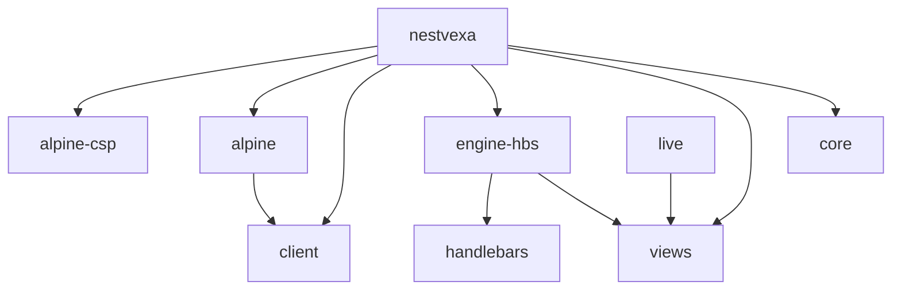

# Package dependency graph

The graph shows declared runtime package dependencies. `alpine-csp` denotes `@alpinejs/csp`; `alpine` denotes `@nestvexa/alpine`. That bridge also declares optional peer ranges for the CSP and ordinary Alpine distributions. The umbrella pins CSP 3.17.5 for its explicit asset-serving capability. Installing that dependency does not start Alpine or add a SPA renderer. Nest HTTP adapters and the packages' declared Nest/reflect-metadata/RxJS peers remain host-owned.

Core imports no renderer/browser runtime and has no DOM globals. Views currently needs no kernel runtime imports, so it depends on the engine contract rather than importing core unnecessarily. Live is a separate server module using Nest DI and views. Client is browser-oriented, and the Alpine bridge consumes its public operations; neither browser package imports Nest.

The umbrella root implements the MVC bridge. Its explicit `nestvexa/assets` subpath uses Node filesystem/package resolution during Nest initialization to snapshot approved browser distribution files. It does not import those files as server-executed browser modules. The service exports content-hash URLs and serves only its immutable catalog. This dependency layout keeps browser assets available to an HBS host without importing them into core or installing React/Vue/Svelte SPA frameworks. It does not implement automatic Live/Alpine startup or action registration.

All package outputs are ESM with declaration files. Dual CommonJS output is deferred until a demonstrated requirement and identity tests justify it. [Asset hosting and migration](../guides/client-assets.md) describes readiness, prefixes, caching, shutdown and deployment limits.

`pnpm lint` executes [boundary checks](../../scripts/boundaries.mjs), including runtime dependency cycle detection. [Package contract tests](../../tests/contracts.test.ts) check entries and a non-browser core import. Browser DOM, real Nest and packed external-consumer checks remain separate evidence; consult [implementation status](../implementation/STATUS.md) for the executed matrix.
