# Package dependency graph

Refreshed **2026-11-05** for all 28 packages in `packages/`. The graph is the
declared runtime graph from each `package.json`, not an import scan. `pnpm docs:build`
fails when this page drifts from the manifests: every package must be a node, every
workspace `dependencies` edge must be drawn solid (`-->`), every workspace
`peerDependencies` edge dotted (`-.->`), and no undeclared workspace edge may remain.
`pnpm lint` runs [scripts/boundaries.mjs](../../scripts/boundaries.mjs), which rejects
runtime cycles and the forbidden imports listed [below](#enforced-rules).

## Workspace graph

Node ids are the directory names under `packages/`. Third-party nodes are quoted;
host-owned peers (NestJS, `reflect-metadata`, `rxjs`) are omitted from the diagram and
listed in the [table](#manifest-table).

```mermaid
flowchart TD
  subgraph distribution[Default distribution]
    nestvexa[nestvexa]
  end
  subgraph kernel[Kernel and rendering]
    core[core]
    views[views]
    engine-hbs[engine-hbs]
    engine-ejs[engine-ejs]
    engine-pug[engine-pug]
    engine-nunjucks[engine-nunjucks]
  end
  subgraph liveLayer[Live]
    live[live]
    client[client]
    alpine[alpine]
    forms[forms]
    uploads[uploads]
  end
  subgraph frontends[Inertia, Vite and islands]
    inertia[inertia]
    vite[vite]
    react[react]
    vue[vue]
    svelte[svelte]
    islands[islands]
  end
  subgraph services[Optional services]
    actions[actions]
    realtime[realtime]
    cache[cache]
    observability[observability]
    i18n[i18n]
    ui[ui]
    ai[ai]
    flags[flags]
    offline[offline]
  end
  cli[cli]

  nestvexa --> core
  nestvexa --> views
  nestvexa --> engine-hbs
  nestvexa --> live
  nestvexa --> client
  nestvexa --> alpine
  nestvexa -.-> cli
  engine-hbs --> views
  engine-ejs --> views
  engine-pug --> views
  engine-nunjucks --> views
  live --> views
  alpine --> client
  forms -.-> live
  inertia --> views
  islands --> views
  i18n --> views
  ui --> views
  react --> vite
  vue --> vite
  svelte --> vite

  nestvexa --> alpinecsp["@alpinejs/csp 3.17.5"]
  alpine -.-> alpinecsp
  alpine -.-> alpinejs["alpinejs"]
  engine-hbs --> handlebars["handlebars 4.7.10"]
  engine-ejs --> ejs["ejs 7.0.2"]
  engine-pug --> pug["pug 3.0.4"]
  engine-nunjucks --> nunjucks["nunjucks 3.2.4"]
  uploads --> busboy["busboy 1.6.0"]
  cli --> typescript["typescript 6.0.3"]
  react -.-> inertiareact["@inertiajs/react + react"]
  vue -.-> inertiavue["@inertiajs/vue3 + vue"]
  svelte -.-> inertiasvelte["@inertiajs/svelte + svelte"]
  islands -.-> frameworks["react / vue / svelte (optional)"]
  vite -.-> vitepkg["vite (optional)"]
  realtime -.-> ws["ws (optional)"]
  forms -.-> validators["zod / class-validator (optional)"]
```

## Reading the graph

- **Default install.** `nestvexa` is the only package that pulls several others in:
  core, views, the HBS engine, Live, the browser client, the Alpine bridge and the
  Alpine CSP build. Everything else is installed explicitly by the application.
- **The kernel is a leaf.** `@nestvexa/core` and `@nestvexa/views` have no workspace
  dependencies. Live, Inertia, islands, i18n, the UI kit and every engine depend on
  the views contracts rather than on core.
- **Live does not depend on core.** The master specification (ARCH-010) says Live
  "depends on core/views". In code Live needs only the view contracts and Nest, so the
  edge is `live --> views`; the umbrella composes core and Live. This is deliberate
  ([ADR 0001](../adr/0001-architecture.md), evaluated in
  [ADR 0030](../adr/0030-live-kernel-boundary.md)) and keeps Live usable without the
  MVC bridge.
- **Browser packages.** `@nestvexa/client` has no dependencies at all and
  `@nestvexa/alpine` only depends on it. Neither imports `@nestjs/*`.
- **Frontend adapters.** `@nestvexa/react`, `@nestvexa/vue` and `@nestvexa/svelte`
  depend on `@nestvexa/vite` for manifest and SSR helpers and take the official
  Inertia client and framework as **required peers**. `@nestvexa/inertia` (the server
  adapter) depends only on views and never imports a client framework.
- **Standalone optional packages.** actions, realtime, cache, observability, ai,
  flags, offline and uploads have no workspace edges; they integrate through Nest DI
  and public contracts, so installing one never drags in another.
- **Optional peer edges.** `forms -.-> live` lets the forms package offer Live helpers
  from its `@nestvexa/forms/live` subpath without making Live mandatory;
  `nestvexa -.-> cli` lets the `nestvexa` bin delegate to an installed CLI.

## Manifest table

| Package                                                               | Workspace dependencies                                                                                                | Third-party runtime dependencies | Peer dependencies                                                                                                             | `sideEffects` |
| --------------------------------------------------------------------- | --------------------------------------------------------------------------------------------------------------------- | -------------------------------- | ----------------------------------------------------------------------------------------------------------------------------- | ------------- |
| [@nestvexa/actions](../../packages/actions/README.md)                 | —                                                                                                                     | —                                | `@nestjs/common`, `@nestjs/core`, `reflect-metadata`, `rxjs`, `typescript` (optional)                                         | false         |
| [@nestvexa/ai](../../packages/ai/README.md)                           | —                                                                                                                     | —                                | `@nestjs/common`, `reflect-metadata`, `rxjs`                                                                                  | false         |
| [@nestvexa/alpine](../../packages/alpine/README.md)                   | `@nestvexa/client`                                                                                                    | —                                | `@alpinejs/csp` (optional), `alpinejs` (optional)                                                                             | false         |
| [@nestvexa/cache](../../packages/cache/README.md)                     | —                                                                                                                     | —                                | —                                                                                                                             | false         |
| [@nestvexa/cli](../../packages/cli/README.md)                         | —                                                                                                                     | `typescript@6.0.3`               | —                                                                                                                             | false         |
| [@nestvexa/client](../../packages/client/README.md)                   | —                                                                                                                     | —                                | —                                                                                                                             | false         |
| [@nestvexa/core](../../packages/core/README.md)                       | —                                                                                                                     | —                                | `@nestjs/common`, `reflect-metadata`, `rxjs`                                                                                  | false         |
| [@nestvexa/engine-ejs](../../packages/engine-ejs/README.md)           | `@nestvexa/views`                                                                                                     | `ejs@7.0.2`                      | —                                                                                                                             | false         |
| [@nestvexa/engine-hbs](../../packages/engine-hbs/README.md)           | `@nestvexa/views`                                                                                                     | `handlebars@4.7.10`              | —                                                                                                                             | false         |
| [@nestvexa/engine-nunjucks](../../packages/engine-nunjucks/README.md) | `@nestvexa/views`                                                                                                     | `nunjucks@3.2.4`                 | —                                                                                                                             | false         |
| [@nestvexa/engine-pug](../../packages/engine-pug/README.md)           | `@nestvexa/views`                                                                                                     | `pug@3.0.4`                      | —                                                                                                                             | false         |
| [@nestvexa/flags](../../packages/flags/README.md)                     | —                                                                                                                     | —                                | `@nestjs/common`, `@nestjs/core`, `reflect-metadata`, `rxjs`                                                                  | false         |
| [@nestvexa/forms](../../packages/forms/README.md)                     | —                                                                                                                     | —                                | `@nestjs/common`, `@nestvexa/live` (optional), `class-transformer` (optional), `class-validator` (optional), `zod` (optional) | false         |
| [@nestvexa/i18n](../../packages/i18n/README.md)                       | `@nestvexa/views`                                                                                                     | —                                | `@nestjs/common`, `@nestjs/core`, `reflect-metadata`, `rxjs`                                                                  | false         |
| [@nestvexa/inertia](../../packages/inertia/README.md)                 | `@nestvexa/views`                                                                                                     | —                                | `@nestjs/common`, `@nestjs/core`, `reflect-metadata`, `rxjs`                                                                  | false         |
| [@nestvexa/islands](../../packages/islands/README.md)                 | `@nestvexa/views`                                                                                                     | —                                | `react` (optional), `react-dom` (optional), `vue` (optional), `svelte` (optional)                                             | false         |
| [@nestvexa/live](../../packages/live/README.md)                       | `@nestvexa/views`                                                                                                     | —                                | `@nestjs/common`, `@nestjs/core`, `reflect-metadata`, `rxjs`                                                                  | false         |
| [nestvexa](../../packages/nestvexa/README.md)                         | `@nestvexa/core`, `@nestvexa/views`, `@nestvexa/engine-hbs`, `@nestvexa/live`, `@nestvexa/client`, `@nestvexa/alpine` | `@alpinejs/csp@3.17.5`           | `@nestjs/common`, `@nestjs/core`, `reflect-metadata`, `rxjs`, `@nestvexa/cli` (optional)                                      | false         |
| [@nestvexa/observability](../../packages/observability/README.md)     | —                                                                                                                     | —                                | `@nestjs/common`, `@nestjs/core`, `reflect-metadata`, `rxjs`                                                                  | false         |
| [@nestvexa/offline](../../packages/offline/README.md)                 | —                                                                                                                     | —                                | —                                                                                                                             | false         |
| [@nestvexa/react](../../packages/react/README.md)                     | `@nestvexa/vite`                                                                                                      | —                                | `@inertiajs/core` (optional), `@inertiajs/react`, `react`, `react-dom`                                                        | false         |
| [@nestvexa/realtime](../../packages/realtime/README.md)               | —                                                                                                                     | —                                | `@nestjs/common`, `@nestjs/core`, `reflect-metadata`, `rxjs`, `ws` (optional)                                                 | false         |
| [@nestvexa/svelte](../../packages/svelte/README.md)                   | `@nestvexa/vite`                                                                                                      | —                                | `@inertiajs/core` (optional), `@inertiajs/svelte`, `svelte`                                                                   | false         |
| [@nestvexa/ui](../../packages/ui/README.md)                           | `@nestvexa/views`                                                                                                     | —                                | —                                                                                                                             | `["*.css"]`   |
| [@nestvexa/uploads](../../packages/uploads/README.md)                 | —                                                                                                                     | `busboy@1.6.0`                   | `@nestjs/common`, `reflect-metadata`, `rxjs`                                                                                  | false         |
| [@nestvexa/views](../../packages/views/README.md)                     | —                                                                                                                     | —                                | —                                                                                                                             | false         |
| [@nestvexa/vite](../../packages/vite/README.md)                       | —                                                                                                                     | —                                | `vite` (optional)                                                                                                             | false         |
| [@nestvexa/vue](../../packages/vue/README.md)                         | `@nestvexa/vite`                                                                                                      | —                                | `@inertiajs/core` (optional), `@inertiajs/vue3`, `vue`                                                                        | false         |

Peer ranges and the singleton rules for NestJS, Alpine and the frontend frameworks are
recorded in [ADR 0029](../adr/0029-peer-dependencies-and-singletons.md); tested
versions are in [upstream compatibility](upstream-compatibility.md).

## Enforced rules

[scripts/boundaries.mjs](../../scripts/boundaries.mjs) (run by `pnpm lint`) fails when:

- any runtime `dependencies` cycle exists between workspace packages;
- `@nestvexa/core` imports React, Vue, Svelte, Live, the client, Inertia or a template
  engine, or touches `window`/`document`;
- `@nestvexa/views` imports a template engine, a renderer or a runtime package;
- the `nestvexa` umbrella declares an alternative engine (`engine-ejs`, `engine-pug`,
  `engine-nunjucks`) as a dependency or peer.

The rest of the script covers browser/server separation and
package-specific import rules; read it for the full list. Packed-consumer tests
([scripts/pack.mjs](../../scripts/pack.mjs)) prove the graph installs from tarballs
without workspace links.

## Output format

Every package is ESM-only with `.d.ts` declarations, declaration maps and source maps
(`tsconfig.base.json`). The [ADR 0007 amendment](../adr/0007-packaging-and-release.md#amendment-2026-11-01-commonjs-hosts)
adds a `default` condition next to `import` so CommonJS Nest apps can load a package
through Node 22.12+ `require(esm)` without a dual-package identity hazard. The browser
client ships one canonical bundle ([ADR 0015](../adr/0015-production-client-bundle.md)).

> **Known gap:** on 2026-11-05 only 13 packages carry the `default` condition (`nestvexa`,
> core, views, engine-hbs, live, client, alpine, inertia, islands, realtime, cache,
> observability, cli). The `exports` of actions, ai, engine-ejs, engine-pug,
> engine-nunjucks, flags, forms, i18n, offline, react, vue, svelte, ui, uploads and vite
> declare only `types`/`import`, so `require()` from a CommonJS host fails with
> `ERR_PACKAGE_PATH_NOT_EXPORTED`; use `await import()` there until the manifests are
> aligned (ARCH-016).
