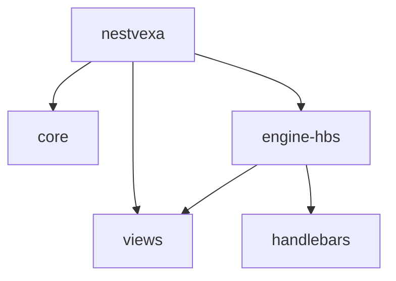

# Package dependency graph

Views currently needs no kernel runtime imports, so it depends on the engine contract rather than importing core unnecessarily. Core has Nest peers, no renderer dependencies, and no DOM globals. Nest HTTP platforms are supplied by the application. All package outputs are ESM with declaration files; dual CommonJS output is deferred until a demonstrated requirement and identity tests justify it.

`pnpm lint` executes [boundary checks](../../scripts/boundaries.mjs), including runtime dependency cycle detection. [Package contract tests](../../tests/contracts.test.ts) check entries and a non-browser core import. Browser packages will require separate DOM/compiler boundaries when implemented.
