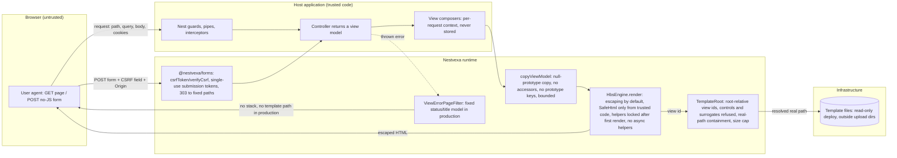
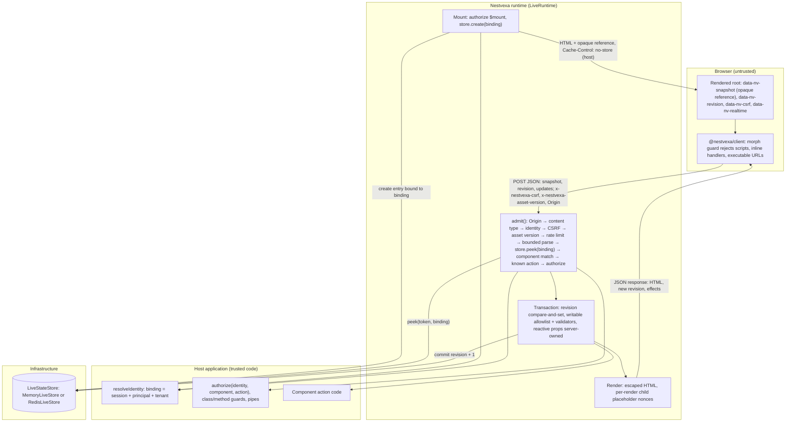
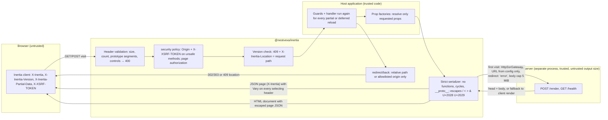
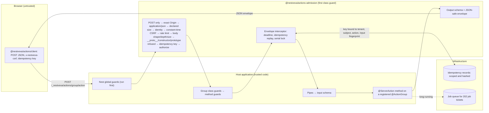
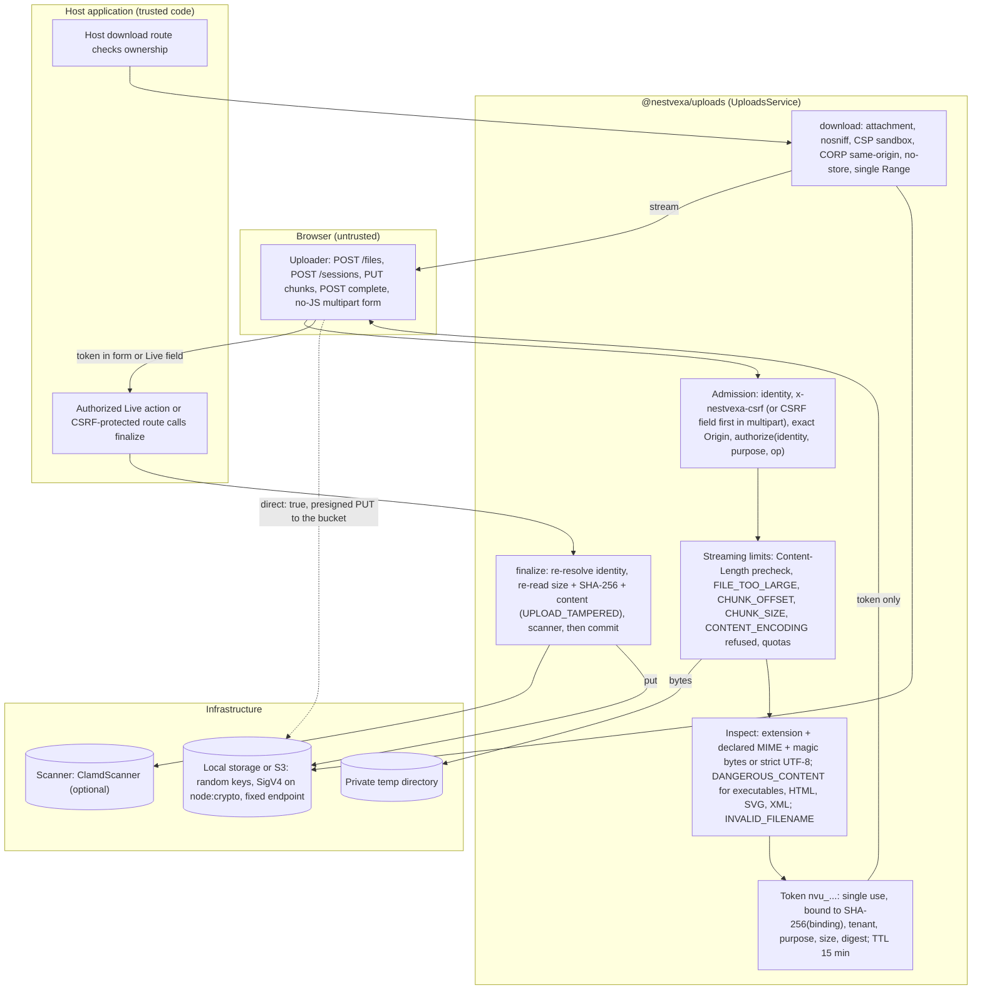
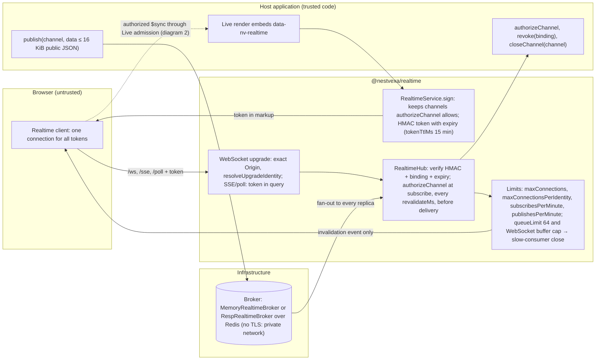
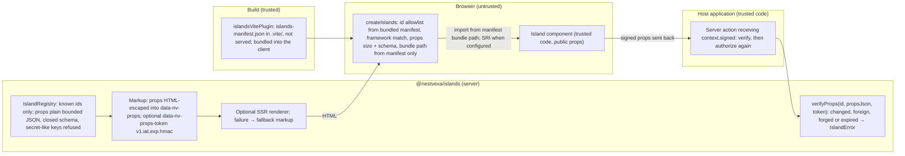

# Threat model diagrams

Date: 2026-11-14. **Internal document** written by the project from the source
code and tests in this repository. It is not an independent or third-party
review and claims no certification. It complements the tables in the
[threat model](threat-model.md) and the [security guide](guide.md).

Each diagram is a data-flow diagram. Every `subgraph` is a trust zone, and every
arrow that leaves a zone crosses a trust boundary. The table under each diagram
lists the controls at each crossing and the test that proves them. Names in
`code` are the real identifiers, error codes and headers in the packages.

Trust zones used in every diagram:

- **Browser (untrusted)**: everything the client sends, including markup that
  devtools or an extension can edit, headers, bodies and replayed requests.
- **Host application (trusted code)**: Nest, the host's guards and
  `resolveIdentity`/`authorize` policies, templates, helpers and components.
  Nestvexa has no sandbox for trusted code.
- **Nestvexa runtime (trusted, enforcing)**: the generated routes and the
  admission checks that run before host code.
- **Infrastructure (trusted, shared)**: state stores, Redis, object storage, the
  SSR server and the filesystem. Content read back from them is still validated.

## 1. MVC: controller and view engine render

| Boundary crossing            | Control                                                                                     | Evidence                                                                             |
| ---------------------------- | ------------------------------------------------------------------------------------------- | ------------------------------------------------------------------------------------ |
| Request data → view model    | `copyViewModel` rejects classes, functions, cycles, accessors and `__proto__`/`constructor` | `tests/views.test.ts`, `tests/views-composition.test.ts`                             |
| View model → HTML            | Escaping by default; fragment-shaped objects and hostile `toHTML` stay escaped              | `tests/views.test.ts`, `tests/forms-view-engines.test.ts`                            |
| View name → filesystem       | Traversal, absolute, alternate separator, stream, null byte and junction escapes refused    | `tests/views.test.ts`, `tests/property-view-paths.test.ts`, `tests/security.test.ts` |
| No-JS form POST → controller | Constant-time CSRF compare, Origin/`Sec-Fetch-Site`, input hardening before adapters        | `tests/forms-hardening.test.ts`, `tests/forms-progressive.test.ts`                   |
| Server error → browser       | Production error views with a fixed model; escaped development page                         | `tests/views-error-pages.test.ts`                                                    |
| Tenant/user data → page      | Pages serve a tenant only to its members                                                    | `tests/multi-tenant-isolation.test.ts`                                               |

## 2. Live: initial render, snapshot reference, actions and state store

Live actions travel as JSON `POST` requests to `/_nestvexa/live` routes. A
realtime WebSocket or SSE message never carries state: it only tells the client
to send the same authorized `$sync` request (see diagram 6).

| Boundary crossing              | Control                                                                                                                                                              | Evidence                                                                                                        |
| ------------------------------ | -------------------------------------------------------------------------------------------------------------------------------------------------------------------- | --------------------------------------------------------------------------------------------------------------- |
| Browser → Live route           | `403 ORIGIN_REJECTED`, `415 CONTENT_TYPE`, `401 IDENTITY_REQUIRED`, `403 CSRF_REJECTED`, `409 ASSET_VERSION_MISMATCH` (after CSRF), `429 RATE_LIMIT` + `Retry-After` | `tests/live-admission.test.ts`, `tests/live-asset-version.test.ts`, `tests/live-request-boundary.test.ts`       |
| Request body → runtime         | Bounded JSON parser (bytes, nodes, depth), prototype keys refused, `413 PAYLOAD_TOO_LARGE`                                                                           | `tests/live-protocol.test.ts`, `tests/property-live-protocol.test.ts`                                           |
| Snapshot reference → state     | Entry readable only with its binding; every failure is `410 INVALID_SNAPSHOT`; `403 COMPONENT_MISMATCH`; `404 UNKNOWN_ACTION`; `403 ACTION_FORBIDDEN`                | `tests/live-store-contract.test.ts`, `tests/kernel-integration.test.ts`, `tests/multi-tenant-isolation.test.ts` |
| Replay and concurrency         | `409 STALE_REVISION` (runs nothing), `409 COMPONENT_BUSY`; resync cannot write state                                                                                 | `tests/live-stale-revision.test.ts`, `tests/live-store-contract.test.ts`                                        |
| Browser updates → state fields | Writable allowlist with validators, `422 STATE_LOCKED`, `409 REACTIVE_PROP_MUTATED`                                                                                  | `tests/live-writable-paths.test.ts`, `tests/property-input-admission.test.ts`, `tests/live-nesting.test.ts`     |
| Server HTML → DOM              | Client refuses scripts, inline handlers, executable URLs and foreign namespaces before morphing; strict CSP and Trusted Types                                        | `tests/client-security.test.ts`, `tests/client-csp.test.ts`, `tests/browser/alpine-injection.spec.ts`           |
| Runtime → Redis store          | Hashed tokens and bindings, versioned records validated on read, optional AES-256-GCM, `503 STORE_UNAVAILABLE` on outage                                             | `tests/live-store-contract.test.ts`                                                                             |

## 3. Inertia: page object, partial reloads, asset version and SSR

| Boundary crossing            | Control                                                                                                 | Evidence                                                                   |
| ---------------------------- | ------------------------------------------------------------------------------------------------------- | -------------------------------------------------------------------------- |
| Request headers → adapter    | Malformed `X-Inertia-*` headers rejected with 400; non-`true` `X-Inertia` is a full page load           | `tests/inertia-security.test.ts`, `tests/property-inertia.test.ts`         |
| Unsafe visit → handler       | `403 ORIGIN_REJECTED`, `403 CSRF_REJECTED`, `403 PAGE_FORBIDDEN`                                        | `tests/inertia-security.test.ts`, `tests/kernel-transports.test.ts`        |
| Partial reload → props       | Guards and handlers re-run; withheld props never resolve                                                | `tests/inertia-reauthorization.test.ts`                                    |
| Props → page JSON / document | Script-closing corpus cannot close the page script or title; hostile props render as text in Vue/Svelte | `tests/inertia-security.test.ts`, `tests/browser/inertia-hostile-props.ts` |
| Redirect targets             | Relative or allowlisted only; foreign `Referer` never followed; request-derived locations encoded       | `tests/inertia-security.test.ts`, `tests/property-inertia.test.ts`         |
| Shared caches                | Responses vary on every content-selecting header                                                        | `tests/cache-poisoning.test.ts`                                            |
| Adapter → SSR server         | Fixed endpoint, no redirects, response size cap                                                         | `tests/ssrf.test.ts`, `tests/inertia-http.test.ts`                         |
| Cross-user data              | Props, flash and errors separate across interleaved users                                               | `tests/inertia-security.test.ts`, `tests/inertia-share-once.test.ts`       |

## 4. Server actions: typed RPC endpoint

| Boundary crossing       | Control                                                                                                    | Evidence                                                                                                 |
| ----------------------- | ---------------------------------------------------------------------------------------------------------- | -------------------------------------------------------------------------------------------------------- |
| Browser → route         | Only decorated methods of registered groups exist; missing/forged/cross-session CSRF refused before guards | `tests/actions-http.test.ts` (only explicitly registered POST actions), `tests/actions-metadata.test.ts` |
| Origin and content type | Wrong or missing Origin and non-JSON bodies refused                                                        | `tests/actions-http.test.ts`, `tests/cors-posture.test.ts`                                               |
| Body → input            | Size, depth and key bounds; prototype pollution refused; input schema                                      | `tests/actions-http.test.ts`, `tests/property-input-admission.test.ts`                                   |
| Identity tokens         | Expired and tampered bearer tokens refused before any guard or handler                                     | `tests/actions-security.test.ts`                                                                         |
| Replays and duplicates  | Idempotency key reuse with different input is a conflict; duplicates in flight get 409                     | `tests/actions-http.test.ts`, `tests/actions-security.test.ts`                                           |
| Policy registry         | Origin, CSRF and authorization decided by the registered policies                                          | `tests/kernel-transports.test.ts`                                                                        |

## 5. Uploads: multipart, chunked, content checks and storage

| Boundary crossing            | Control                                                                                                                                  | Evidence                                                                                           |
| ---------------------------- | ---------------------------------------------------------------------------------------------------------------------------------------- | -------------------------------------------------------------------------------------------------- |
| Browser → upload routes      | Missing CSRF, foreign Origin, unknown or forbidden purposes and other identities refused (`404 UPLOAD_NOT_FOUND`, no oracle)             | `tests/uploads-http.test.ts`                                                                       |
| Byte stream → temp file      | Declared and actual size limits, content codings refused, chunk order/offset/digest checks                                               | `tests/uploads-http.test.ts`, `tests/property-uploads-http.test.ts`                                |
| File content → accepted type | Declared MIME and magic bytes; executables and markup denied even when renamed; traversal and double extensions refused                  | `tests/uploads-validation.test.ts`, `tests/uploads-http.test.ts`, `tests/property-uploads.test.ts` |
| Quotas                       | Per-identity, per-tenant and per-process file and byte quotas                                                                            | `tests/uploads-limits.test.ts`, `tests/uploads-http.test.ts`                                       |
| Token → stored object        | Single-use finalize, expiry sweep, tamper detection                                                                                      | `tests/uploads-http.test.ts`                                                                       |
| Service → S3                 | SigV4 against AWS test vectors; every object, presigned and download URL stays on the configured host; no redirects followed             | `tests/uploads-s3.test.ts`, `tests/ssrf.test.ts`                                                   |
| Stored file → browser        | RFC 5987 names, attachment, `nosniff`, sandbox CSP                                                                                       | `tests/uploads-http.test.ts`, `tests/live-effects.test.ts`                                         |
| Scanner                      | Infected files blocked, `requireScan` needs a configured scanner; `ClamdScanner` tested against a protocol fake only (no real clamd run) | `tests/uploads-s3.test.ts`                                                                         |

## 6. Realtime: channels, tokens, broker and backpressure

| Boundary crossing       | Control                                                                                         | Evidence                                                                                                |
| ----------------------- | ----------------------------------------------------------------------------------------------- | ------------------------------------------------------------------------------------------------------- |
| Token → subscription    | Stolen tokens, unauthorized channels and connection floods refused; token expiry closes         | `tests/realtime.test.ts`, `tests/realtime-hub.test.ts`, `tests/property-realtime-token.test.ts`         |
| WebSocket upgrade       | Subscriptions only from the configured Origin                                                   | `tests/realtime.test.ts`                                                                                |
| Long-lived connection   | Re-authorization before delivery after the revalidation window; identity changes close it       | `tests/realtime.test.ts`, `tests/realtime-hub.test.ts`                                                  |
| Kernel identity         | Token signed for one user or tenant refused for another                                         | `tests/kernel-transports.test.ts`, `tests/multi-tenant-isolation.test.ts`                               |
| Backpressure            | Slow consumers closed, not buffered; replay bounded by `replayChannels`                         | `tests/realtime.test.ts`, `tests/realtime-distributed.test.ts`, `tests/property-realtime-token.test.ts` |
| Event → component state | Channels signed only when authorized; refresh is a read-only `$sync` through admission          | `tests/realtime-live.test.ts`, `tests/live-refresh.test.ts`                                             |
| Broker ↔ Redis          | Cross-replica fan-out and presence (in-process RESP double; real Redis in `pnpm test:services`) | `tests/realtime-distributed.test.ts`                                                                    |

## 7. Islands: signed props and hydration

| Boundary crossing           | Control                                                                                                      | Evidence                                                                  |
| --------------------------- | ------------------------------------------------------------------------------------------------------------ | ------------------------------------------------------------------------- |
| Server props → markup       | Escaped JSON, bounded plain values, closed schemas, secret-like keys refused                                 | `tests/islands.test.ts`                                                   |
| Signed props → server       | Tampered, foreign, expired and unsigned tokens rejected                                                      | `tests/islands.test.ts`                                                   |
| Markup → module import      | Ids outside the build-time allowlist load nothing; manifest framework, size, schema and bundle path enforced | `tests/islands-client.test.ts`                                            |
| Manifest → bundle paths     | Scheme-relative, absolute, `..` and non-`.js` paths rejected                                                 | `tests/islands.test.ts`, `tests/islands-vite.test.ts`                     |
| Asset bytes → browser       | SHA-384 integrity and `crossorigin` on production tags when configured                                       | `tests/vite-integrity.test.ts`, `tests/assets-integrity.test.ts`          |
| Hydration in a real browser | Islands mount once, deferral strategies load chunks only when due                                            | `tests/browser/islands.spec.ts`, `tests/browser/islands-deferral.spec.ts` |

## What these diagrams do not show

- Host-owned controls: authentication, session cookies, TLS termination, proxy
  trust, CSP headers and edge rate limits ([hardening](hardening.md),
  [CSP and headers](../deployment/csp-and-headers.md)).
- Release and supply chain flows (see the threat model table rows for
  "Source → tarball" and "Release pipeline → npm").
- Residual risks listed in the [threat model](threat-model.md#residual-risks-and-host-responsibilities).
